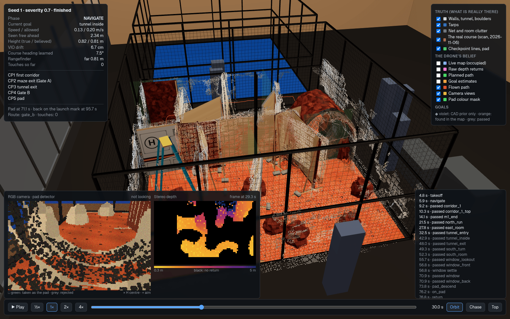
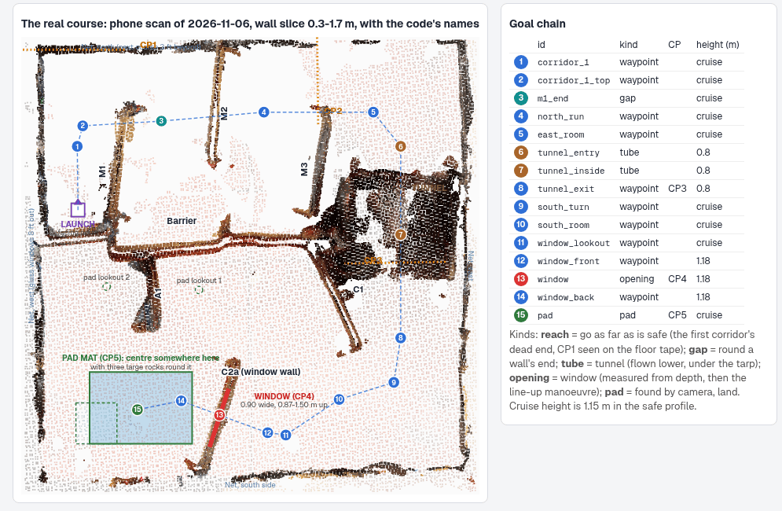
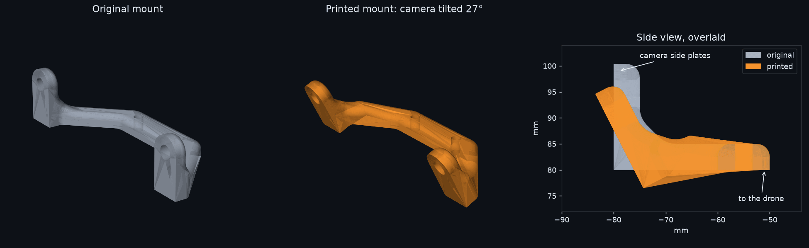

# Team Snow Crashers
***Entry for Stanford's 2026 [Drone Hacks](https://dronehacks.groups.stanford.edu/) competition***

Our team successfully flew the first autonomous flight of the hackathon, and developed and validated a reasonably accurate simulator.

## The naive approach

The naive approach would be to fully trust the course CAD the organizers provided. With this assumption, one should simply solve for the optimal path and fly it as fast as possible, as shown below.

## Modeling the real course

Of course, theory and reality are rarely the same. The real course dimensions were far from the ideal. There were even some additional obstacles, such as this ladder, which had to be modeled:

Thankfully, with the help of a Gaussian splat of the course, agents are quite capable of adjusting geometry accordingly. Even with more accurate geometry, though, the panels and other elements on the course can get moved around between runs. So, we modified our simulator to account for slightly random positions within sane constraints.

## The simulator

Our simulator accounts for a number of effects, such as the ground effect, and simulates the flight stack, which allowed us reasonable confidence in our algorithms. Unfortunately, with only the resources to run one simulation at a time, it was too computationally intensive to gain meaningful results from.

## Navigation

Our intended algorithm was to set dynamic waypoints based on perceived geometry. This way, even if course elements were out of line, the drone would still be able to navigate to the end.

## Finding the landing pad

In order to recognize the landing pad, our team also modified the provided camera mount to face downwards. This allows us to use basic histogram back projection to find the final landing pad by its color, then confirm it by its simple shape and the known fact that it will be on the floor.

---

*For the sake of speed (quite valuable in a hackathon), code was largely AI generated with human guidance.*
