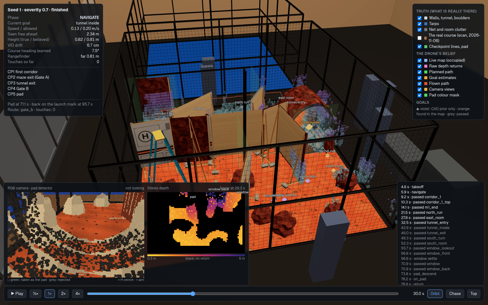
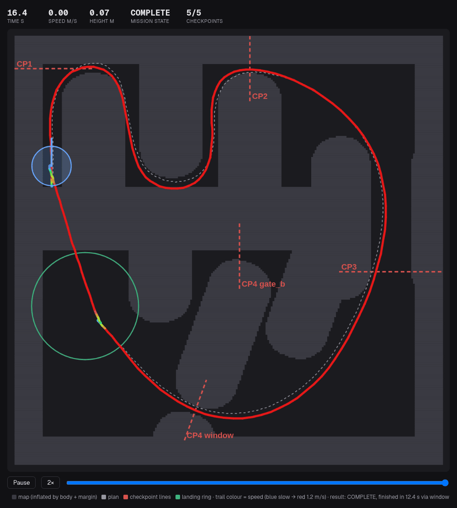
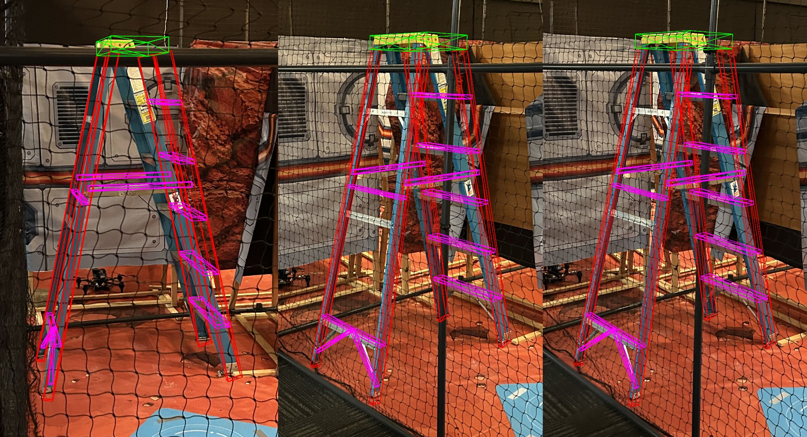

# Snow Crashers

Our entry for Stanford DroneHacks 2026. The Sky Beta quadcopter (skybeta-03) must fly the
course by itself: around walls, through a window, onto a landing mat, then back home. It does
this with an OAK-D camera, PX4 and the organizers' `flight_interface`.

## From a plan on the CAD to navigating the course as built

**First approach: race the CAD.** We planned a minimum-time path through the organizers' CAD
course and checked it in a portable simulator. That simulator ran our real mission nodes over
a fake ROS layer, with PX4's offboard control laws and an independent referee. On the CAD it
finished in 12.4 s and came back home.

**Then the real course.** A phone scan of the hall showed that the course did not match the
CAD: walls had moved and turned, and there were tarps, a ladder and rocks. A replayed plan would
hit them, so we replaced it with a goal navigator. It builds a map from its own depth as it
flies, finds each goal in the chain within that map, plans around what it sees, and finds
the mat by colour. The simulator builds the course from the scan and jitters every wall within
its measured uncertainty. The 3D viewer shows the truth beside what the drone believed.

| The phone scan over the simulated course | The course map and the goal chain |
|---|---|
|  |  |

The simulator was fitted to real photos. When the walls were rebuilt and the ladder moved, we
solved their positions from team photos and checked them by drawing the model back over those
photos:

In the last batch (2026-11-08, 25 seeds) the drone landed on the pad without touching anything
in 24 runs. These are simulated runs; they don't guarantee the real drone does the same.

## On the real drone

- Simple take-off, move and land flights worked. Wall crossing with CPU stereo depth worked
  too ([status](docs/STATUS.md)). Video: [flight on 2026-11-07](photos/flight_2026-11-07.mp4),
  [the ladder](photos/Ladder_Vid.mp4).
- `tools/fly` runs each stage (deploy, check, fetch logs, hand back) with one command, and only on our own
  drone. `tools/postflight.py` summarises a flight log in a minute.
- `tools/ps5` adds a manual mode. A DualSense controller nudges the mission or flies it after
  the automatic take-off, while the RC kill switch still rules.
- `tools/manual-flight` flies by hand with every sensor recorded.
- Depth and colour rates, VIO fusion and CPU load were measured on the drone. The simulator is
  tuned to those numbers ([camera notes](docs/CAMERAS.md), [logs](docs/logs/)).

## Where things are

| Path | What |
|---|---|
| [`docs/`](docs/README.md) | All guides, notes, logs and organizer material. Start at the index |
| [`goalnav/`](goalnav/README.md) | The goal navigator and the 3D course simulator |
| [`team_ws/`](team_ws/DRONE_SETUP.md) | ROS 2 packages that run on the drone (`snowcrashers_nav`, `overwall_nav`, `manual_flight`) |
| [`tools/`](tools/) | Fly, deploy, fetch logs, drone lock, PS5 remote, bench tools |
| [`skybetav1/`](skybetav1/README.md) | The organizers' stack (0.3.2), for reference |
| [`cad/`](cad/) | The camera mount, original and modified |
| [`photos/`](photos/) | The team's photos and videos of the course and flights |
