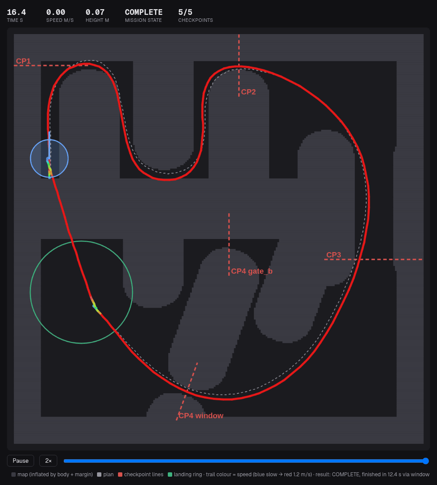
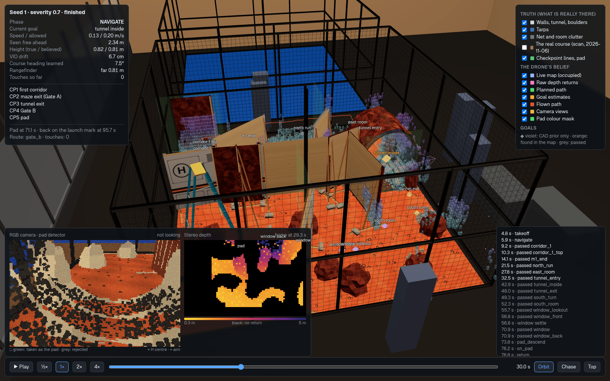
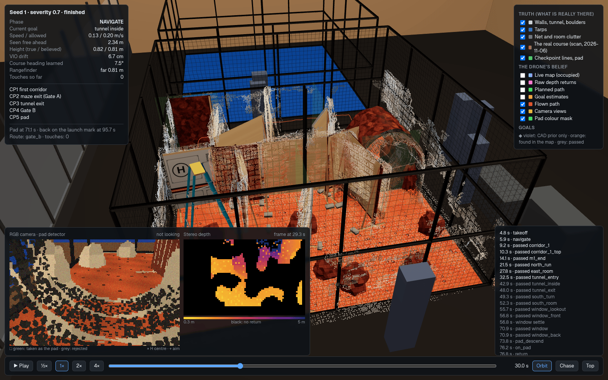
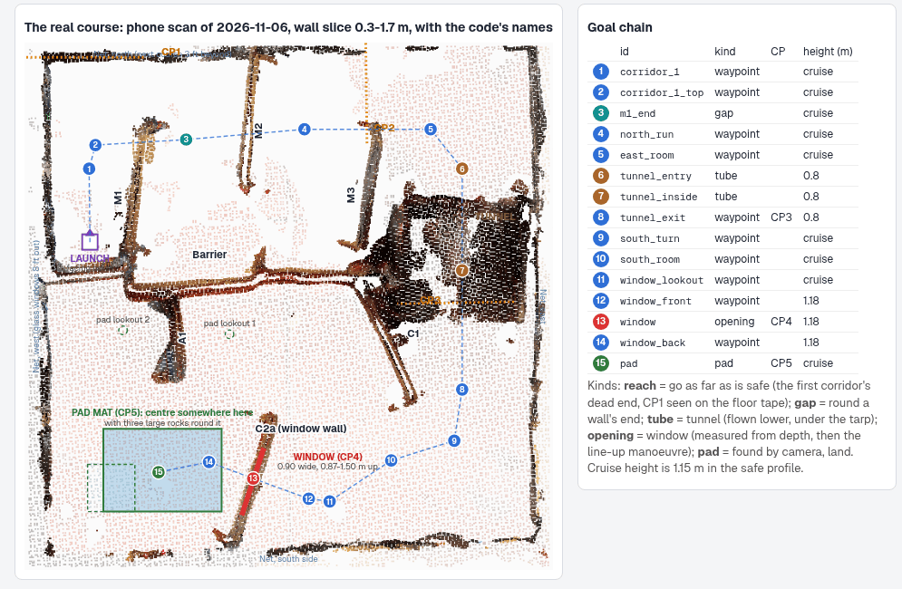

# Simulation

Two simulators were built, one after the other.

## First: the race replay on the published CAD (prep repo, 2026-11-03)



The first approach planned a minimum-time race through the organizers' CAD course and flew it
in a portable simulator: our real mission nodes over a fake ROS layer, PX4's offboard control
laws at default gains, an independent referee, and a 2D animated replay. On the CAD it finishes
in about 12.4 s, lands on the pad and returns. The weak point was the assumption that the course
is exactly where the CAD puts it. It lives in the
[prep repo](https://github.com/lukemitchellandrews/DHSnowCrashersPrep)
(`reference_stack/localsim`, guide `reference_stack/docs/LOCAL_SIM.md`).

## Now: goal navigation on the course as built



The phone scan of 2026-11-06 showed the real course differs from the CAD (walls moved and
turned, tarps, a ladder, rocks), so the race stack was dropped. The goal navigator flies a chain
of goals it finds in a live map built from its own depth, and the simulator builds the course as
scanned, with each seed jittering wall poses within the measured uncertainty. The 3D viewer
shows the truth beside what the drone believed: its growing map, raw depth returns, goal
estimates, planned path, the RGB pad detector and the stereo depth image.





## Run it

From `goalnav/`:

```sh
python3 -m localsim.goalrun --seed 1 --severity 0.7 --profile safe --duration 90 --out localsim/out/goalnav/s1
```

Install `localsim/requirements.txt`, or supply those dependencies with Nix.
The command normally writes `report.json`, `trace.json`, a 3D `viewer.html` and
camera frames. Keep the adjacent `cam/` directory with the viewer.

`python3 -m localsim.live_index localsim/out/goalnav` makes one page that always shows the
newest run, and `PYTHONPATH=. python3 tools/course_map.py . localsim/out/goalnav/s1 out.html`
draws the labelled course map above for a run.

**The stepladder** sits where the team last saw it, its **original spot** between the barrier
and the mat. If it moves, change `DEFAULT_POSE` in `goalnav/localsim/messy_ladder.py`
(`'original'` or `'moved'`, the south-west net corner), or pass `--ladder-pose moved` for one run.
This only affects the simulator.

Last batch (2026-11-08, ladder in its original spot, 25 runs): **24 of 25** landed on the
helipad with no contact before landing. Simulator results don't guarantee the real drone does
the same.

## Match the branch

- `localsim.goalrun --camera rgbstereo` (the default) models the drone's team camera config:
  goalnav's CPU stereo points from the mono pair (~4.5 Hz, ~0.13 s old) and colour for the pad,
  as `goalnav.launch.py camera:=rgbstereo` runs on the drone.
- `--camera rgbd` models the on-camera depth Image instead (10 Hz, 0.1 s; add `--colour` for the
  pad). That camera config cost PX4 its VIO fusion on skybeta-03, so it is not what flies.
- `origin/agent/sim-walls` contains rebuilt-maze/ladder geometry. The older
  scan layout includes walls that have since moved or been removed. Even the
  rebuilt version retains unresolved floor-tape/checkpoint placement.

Run `python3 -m localsim.goalrun --help` on the checkout being used. Record the
commit, layout, seed, sensor flags and tuning with a result; do not transfer
results between these versions as if they were the same experiment.

## What a successful run proves

The goalrun path executes the goal navigator and organizer flight-interface
code against fake ROS and a Python vehicle model. It models noisy sensing,
odometry, geometry and rough dynamics. It does **not** run the real camera,
cuVSLAM, DDS transport or PX4 firmware. Simulated depth and colour are rendered;
the referee and replay see ground truth independently of the navigator.

The cheese shortcut (climb over the barrier straight to the mat) was dropped on 2026-11-08:
the team flies the full course. Its code is in git history (PR #24 removed it).

The former race stack and its guide (`goalnav/docs/LOCAL_SIM.md`) were removed on
2026-11-07: no race or fast modes, we play it safe. `localsim/run.py --px4` remains
for PX4 SITL.
[Organizer AI_CONTEXT.md](organizer/AI_CONTEXT.md) describes a
separate lab simulator; its ROS version, topics and arming example are not the
hardware deployment contract. [The Isaac/Pegasus spike](../skybetav1/sim/README.md)
is another separate path and is documented as unexecuted.
